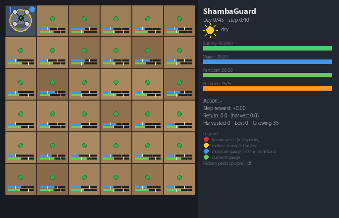

# ShambaGuard

**A farm-drone reinforcement learning environment, and a comparison of DQN, REINFORCE, A2C and PPO on it.**

On a small Kenyan *shamba* (farm), most crop is lost in the gaps between visits: a plot that dries out on a hot day, a pest outbreak nobody saw until it spread, maize left in the field after it ripened. ShambaGuard puts one battery-powered drone in charge of a 6×6 maize farm for a 45-day season. It has to decide, ten times a day, where to fly and whether to irrigate, fertilize, scan, spray, harvest or fly home to recharge, with limited battery, water, fertilizer and pesticide, and pests it can only see by scanning.



*The best trained agent (REINFORCE, run 1) on season seed 1002: 20 plots harvested, none lost.*

**Video:** https://drive.google.com/file/d/1qi_tMVuwtKoHoST3Xkh-rOGJkcN09u26/view?usp=sharing

---

## Results at a glance

| Agent (best run, mean of 3 training seeds) | Task return per season | Plots harvested | Plots lost |
|---|---|---|---|
| **REINFORCE** (run 1) | **+157.8** | 20.3 | 2.2 |
| PPO (run 4, clip 0.1) | +141.4 | 19.0 | 3.2 |
| A2C (run 2, lr 1e-5) | +125.6 | 17.6 | 4.4 |
| DQN (run 9, hard target update) | +115.2 | 16.0 | 2.8 |
| Greedy heuristic + fertilizer | +162.8 | 20.5 | 1.7 |
| Greedy heuristic | +106.8 | 12.1 | 1.0 |
| Random (valid actions) | −32.0 | 0.0 | 0.5 |
| Any algorithm trained from scratch (run 0) | −20 to −88 | ≤ 3 | — |

Final evaluation: 50 seasons on fixed seeds 1000–1049, greedy actions, *task return* = environment reward without the shaping term (so all agents are compared on the same scale). Standard error is about ±15.

**What we found**

1. **From scratch, none of the four algorithms learned to farm in 200k frames.** Each settled into doing as little as possible (about −20). We tried action masking, removing an early-harvest loophole, potential-based reward shaping and treating the season end as terminal; none of it was enough on its own.
2. **The fix that mattered was the observation.** Adding 27 navigation features (direction and distance to the nearest dry, infested, low-nutrient and ripe plot, plus the battery margin for the trip home) let a network imitate the greedy heuristic perfectly: behaviour cloning + DAgger went from 85% to 100% action accuracy and from +33 to +159 task return.
3. **All four algorithms were therefore warm-started from the heuristic, then trained with RL.** REINFORCE, A2C and PPO start from the cloned policy network (A2C and PPO first warm up their critic); DQN learns from 200 demonstration seasons kept in a permanent replay buffer with a large-margin loss (DQfD). Fine-tuning kept heuristic-level play but did not beat it. REINFORCE at a small learning rate moved the policy least and stayed level with the heuristic; DQN was the most fragile (seed results ranged from +79 to +135).
4. **Larger learning rates and smaller batches wreck a warm-started policy**: A2C at lr 3e-4 fell to −40, REINFORCE with one episode per update to +50 (Fig 7).
5. **Generalization:** on unseen seeds every agent held its level. Under a harsher drought and a high-pest season, the RL agents lost more ground than the heuristic they started from; DQN kept only 27% of its return under high pest (Fig 6).

## The environment

| | |
|---|---|
| Farm | 6×6 grid; base station at (0, 0), 35 maize plots |
| Episode | 45 days × 10 actions per day = 450 steps |
| Actions (11) | `MOVE_N/S/E/W`, `IRRIGATE`, `FERTILIZE`, `SCAN`, `SPRAY`, `HARVEST`, `RECHARGE`, `WAIT` |
| Observation (261 floats in [0, 1]) | 6 per-plot maps (moisture, nutrient, growth, health, *known* pest level, crop present) = 216; drone position and the plot under it = 8; battery, water, fertilizer, pesticide, day, step, weather, distance home = 10; navigation features = 27 |
| Resources | battery 100 (moves and actions cost charge), water tank 20 (refilled at base), fertilizer 20, pesticide 15 |
| Hidden state | pests are only visible after a `SCAN` (3×3 area) or once they are severe |
| Weather | dry / normal / wet days with different rain chances and evaporation |
| Episode ends | season over (day 45), drone stranded with an empty battery away from base, or no crops left |

**Rewards**

| Event | Reward |
|---|---|
| Harvest a mature plot | +10 × yield (yield depends on the plot's health) |
| A crop dies | −3 |
| Spray an infested plot / a clean plot | +0.5 / −0.5 |
| Irrigate a dry plot / an already wet plot | +0.1 / −0.2 |
| Invalid action | −0.1 |
| Every step | −0.01 |
| Drone stranded (battery empty away from base) | −20 |
| Potential-based shaping, γ·Φ(s′) − Φ(s) | Φ rewards growing, healthy, well-tended crops; it cancels out over a season, so it guides learning without changing which policy is optimal |

Invalid actions (for example `HARVEST` on an unripe plot) are masked out for the agents. Difficulty presets: `standard` (training and the report), `easy` (debugging), `drought` and `high_pest` (generalization tests only), `spec_v1` (the original spec numbers, kept for reference).

## Install and run (uv)

Dependencies are managed with [uv](https://docs.astral.sh/uv/) (`pyproject.toml` + `uv.lock`; Python 3.11–3.14, results were produced on 3.14). uv creates the virtual environment and installs everything, including the CPU build of PyTorch:

```bash
git clone https://github.com/ayioka/shem_ayioka_rl_summative.git
cd shem_ayioka_rl_summative
uv sync                  # creates .venv and installs the locked dependencies
uv run main.py           # best trained agent: Pygame window + verbose terminal output
uv run pytest -q         # 22 environment tests
```

Without uv: `pip install -r requirements.txt` (see the comment in that file for the CPU PyTorch index), then `python main.py`.

## Watch an agent

```bash
uv run main.py                         # best agent (models/best.json): live window + one line per step
uv run play.py                         # same thing
uv run main.py --algo dqn --run 9      # any trained run
uv run main.py --agent greedy+fert     # the heuristic baseline
uv run main.py --preset drought --seed 7
uv run main.py --no-render --episodes 20 --quiet   # just score 20 seasons
uv run main.py --gif assets/season.gif # save a GIF
```

In the window, `D` shows the hidden (unscanned) pests and `Esc` quits. Each terminal line looks like
`Day 12 | step 4 | IRRIGATE  -> (2, 3) | r=+0.10 | batt  61 | water 13 | return 84.2`.

To use a trained policy from other code (a farm dashboard, an API):

```python
from training.policy import load_best
agent = load_best()
action = agent.predict(obs, info["action_mask"])
```

## Train

```bash
uv run training/bc.py --dagger 4                            # greedy clone -> models/bc/bc_greedy.pt
uv run training/pg_training.py --algo ppo --run 4           # one run from configs/ppo.yaml
uv run training/pg_training.py --algo reinforce --run 1 --seed 1 --tag _seed1
uv run training/dqn_training.py --run 9
uv run scripts/run_sweep.py --algos ppo a2c --workers 4     # whole sweeps, resumable
```

Each algorithm has 11–12 runs in `configs/<algo>.yaml`: run 0 trains from scratch with the spec's baseline settings, run 1 is the warm-started baseline, runs 2–9 change one hyperparameter each, run 10 combines the best changes (DQN run 11 = Double DQN). Every run trains for 200k environment frames. Models go to `models/pg/<algo>_<run>.pt` and `models/dqn/dqn_<run>.pt`, each with a `.config.json` holding its settings and final scores; logs go to `logs/<algo>/`.

`notebooks/colab_sweeps.ipynb` runs the sweeps on Google Colab (`uv run scripts/pack_colab.py` builds the upload).

## Reproduce the results and figures

```bash
uv run scripts/summarize_sweeps.py --baselines   # sweep tables -> logs/sweep_summary.csv
uv run scripts/pick_best.py                      # -> models/best.json
uv run scripts/generalize.py                     # unseen seeds, drought, high pest -> logs/generalization.csv
uv run scripts/make_figures.py                   # figures/fig1 ... fig7
```

| Figure | Shows |
|---|---|
| [Fig 1](figures/fig1_environment.png) | The environment and HUD, labelled |
| [Fig 2](figures/fig2_reward_curves.png) | Task return during training: best runs (3 seeds) and from-scratch runs |
| [Fig 3](figures/fig3_dqn_loss_q.png) | DQN TD loss and mean Q |
| [Fig 4](figures/fig4_entropy.png) | Policy entropy (REINFORCE, A2C, PPO) and DQN's ε schedule |
| [Fig 5](figures/fig5_convergence.png) | Frames until each best run's return settles |
| [Fig 6](figures/fig6_generalization.png) | Generalization to unseen seeds, drought and high pest |
| [Fig 7](figures/fig7_sweeps.png) | Every sweep run's final return |

## Hyperparameter sweeps (final task return, seed 0, 50 evaluation seasons)

| Run | PPO | A2C | REINFORCE | DQN |
|---|---|---|---|---|
| 0 from scratch | −61 | −20 | −88 | −36 |
| 1 warm-start baseline | +137 | +120 | **+164** | +94 |
| 2 | lr 1e-5: +118 | lr 1e-5: **+123** | lr 1e-5: +162 | lr 1e-4: +19 |
| 3 | lr 1e-4: +114 | lr 3e-4: −40 | lr 1e-4: +42 | lr 2e-3: +66 |
| 4 | clip 0.1: **+150** | γ 0.95: +36 | γ 0.95: +144 | γ 0.95: +13 |
| 5 | clip 0.3: +132 | λ 0.95: +8 | γ 0.999: +161 | buffer 10k: +105 |
| 6 | λ 0.8: +140 | 32 frames/batch: +38 | 1 episode/update: +50 | batch 32: +36 |
| 7 | entropy 0: +117 | 512 frames/batch: +59 | 16 episodes/update: +161 | ε decay 30k: +27 |
| 8 | entropy 0.01: +144 | entropy 0.01: +109 | entropy 0.01: +150 | ε end 0.1: +45 |
| 9 | small batches: +107 | value coef 1, grad norm 5: +106 | value baseline: +154 | hard target update: **+135** |
| 10 best combination | +147 | +115 | +162 | +133 |
| 11 | | | | Double DQN: +58 |

Combining the best single changes (run 10) never beat the best single change. Full settings: `configs/*.yaml`; full table: `logs/sweep_summary.csv`.

## Generalization

Each agent's best run (3 training seeds averaged) and the baselines, 50 seasons per condition, task return. None of these conditions was seen in training ([Fig 6](figures/fig6_generalization.png), `uv run scripts/generalize.py`).

| Agent | Final-eval seeds (1000–1049) | Unseen seeds (5000–5049) | Drought | High pest | Plots lost: drought / high pest |
|---|---|---|---|---|---|
| REINFORCE | +157.8 | +185.1 | **+52.4** | **+128.2** | 14.6 / 6.3 |
| PPO | +141.4 | +162.1 | +22.9 | +94.0 | 17.3 / 8.7 |
| A2C | +125.6 | +148.4 | +13.7 | +94.8 | 17.9 / 9.3 |
| DQN | +115.2 | +129.9 | +37.5 | +34.8 | 15.5 / 7.6 |
| Greedy + fert | +162.8 | +190.6 | +66.6 | +156.8 | 13.3 / 4.2 |
| Greedy | +106.8 | +114.2 | +40.1 | +86.0 | 10.5 / 4.2 |
| Random | −32.0 | −32.6 | −34.4 | −32.6 | 1.5 / 1.1 |

- **Unseen seeds:** no overfitting to the training seasons. Every agent scores higher, because seeds 5000–5049 happen to be slightly easier seasons than 1000–1049.
- **Drought** (rain about 2.5× rarer, soil dries 1.5× faster) is the hardest test: every agent loses most of its return and 13–18 of 35 plots. Since water refills only at base, the policy has to plan more refill trips than it ever needed in training.
- **High pest** (outbreaks 3× as often, 4 plots infested at the start) separates the methods: REINFORCE keeps 69% of its unseen-seed return, PPO 58%, A2C 64% and DQN only 27% (one DQN seed falls to −7). The heuristic keeps 82%.
- **RL training made the imitated policy more brittle.** All four agents started from the greedy + fert heuristic (the three policy-gradient methods as its clone, DQN from its demonstrations), and all four now hold up worse than the heuristic under both shifts. REINFORCE, which changed the clone least, kept the most; DQN, which builds its own Q-function, kept the least.

The `drought` preset was made harder after a first test: rarer rain on its own made the season *easier* (+195 for greedy + fert), because rain can only push moisture above the ideal band while the drone irrigates freely. The faster drying was added so that water actually runs short.

## Project layout

```
pyproject.toml, uv.lock     uv project and locked dependencies
environment/custom_env.py   EnvConfig, presets, ShambaGuardEnv (Gymnasium)
environment/rendering.py    Pygame renderer (live window or RGB frames)
environment/baselines.py    random and greedy heuristic agents
training/common.py          TorchRL env factory, evaluation, logging
training/pg_training.py     REINFORCE, A2C, PPO
training/dqn_training.py    DQN (+ demonstrations, Double DQN option)
training/bc.py              behaviour cloning + DAgger of the greedy heuristic
training/policy.py          load a trained model; predict(obs, mask) -> action
configs/*.yaml              sweep configurations
scripts/                    sweeps, summaries, generalization, figures, visualization
main.py, play.py            watch the best agent
tests/test_env.py           environment tests
models/, logs/, figures/    trained weights, training logs, report figures
```
